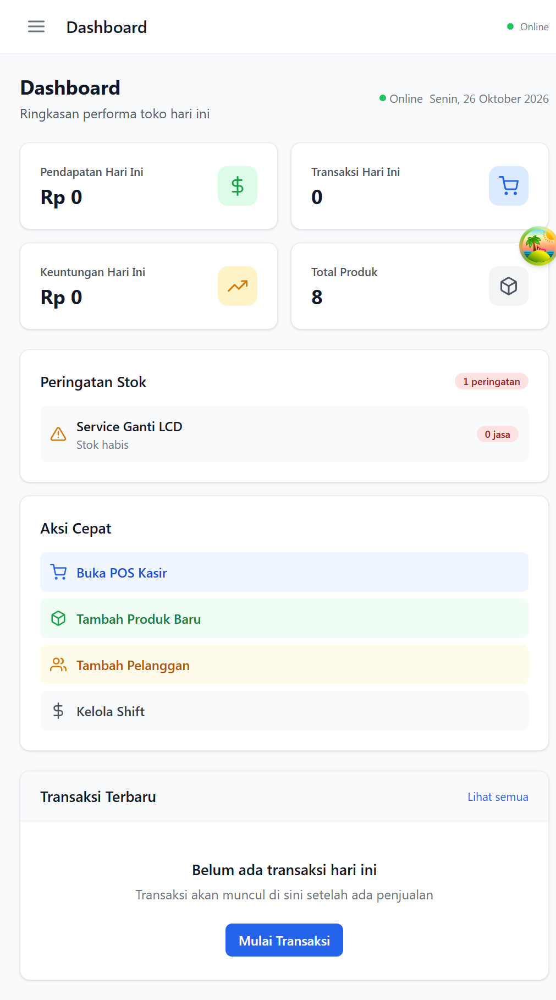

# Konteros POS

Aplikasi web kasir dan manajemen toko untuk konter pulsa/PPOB dan bisnis ritel. Aplikasi menyediakan alur transaksi POS, pengelolaan stok, pelanggan, shift, dan laporan dalam satu dashboard.

Repository tugas: [github.com/kingmuller1325-creator/web_konter](https://github.com/kingmuller1325-creator/web_konter)

## Fitur

- Login, pendaftaran, dan akses berdasarkan peran pengguna.
- Dashboard ringkasan operasional.
- POS dengan keranjang belanja, pembayaran, dan struk.
- CRUD produk, kategori, dan pelanggan.
- Inventori dan pencatatan pergerakan stok.
- Riwayat transaksi dan detail transaksi.
- Buka/tutup shift kasir dan laporan penjualan.
- Pengaturan outlet dan pengelolaan modul.
- PWA dengan penyimpanan lokal untuk membantu alur kerja saat offline dan sinkronisasi ketika tersambung kembali.

## Teknologi

- Frontend: React 18, TypeScript, Vite, Tailwind CSS, Zustand, TanStack Query, dan Dexie.
- Backend: NestJS 10, TypeScript, Prisma ORM, dan PostgreSQL.
- Infrastruktur pengembangan: pnpm workspace; Docker Compose menyediakan PostgreSQL dan Redis.

## Menjalankan di Windows

### Prasyarat

- Node.js 20 atau lebih baru.
- pnpm 9.
- Docker Desktop (untuk menjalankan PostgreSQL dan Redis secara lokal).

### Instalasi dan database

Buka PowerShell pada folder proyek, lalu jalankan:

```powershell
pnpm install
docker compose -f infra\docker-compose.yml up -d
```

Salin konfigurasi API contoh hanya jika file lokal belum tersedia. Jangan unggah file `.env` ke GitHub:

```powershell
if (!(Test-Path apps\api\.env)) {
  Copy-Item apps\api\.env.example apps\api\.env
}
```

Tidak diperlukan file `.env` frontend untuk pengembangan lokal: Vite meneruskan permintaan `/api` ke API lokal di port 3000. Jalankan migrasi dan data demo:

```powershell
pnpm --filter @konteros/api db:generate
pnpm --filter @konteros/api db:migrate
pnpm --filter @konteros/api db:seed
```

### Menjalankan aplikasi

```powershell
pnpm dev
```

Biarkan terminal tetap terbuka. Akses:

- Aplikasi: http://localhost:5173
- Dokumentasi API (Swagger): http://localhost:3000/docs
- Pemeriksaan API: http://localhost:3000/api/v1/health
- Pemeriksaan koneksi database: http://localhost:3000/api/v1/health/db

Untuk menjalankan frontend atau backend secara terpisah, gunakan `pnpm dev:web` atau `pnpm dev:api`. Hentikan proses dengan `Ctrl+C`; hentikan layanan database Docker dengan `docker compose -f infra\docker-compose.yml down`.

### Akun demo

Setelah database di-seed:

| Peran | Email | Password |
|---|---|---|
| Admin | `admin@konteros.com` | `admin123` |
| Kasir | `kasir@konteros.com` | `kasir123` |

Akun ini hanya untuk demonstrasi lokal. Jangan gunakan kredensial demo atau secret contoh untuk deployment publik.

## Perintah pengembangan

```powershell
pnpm build
pnpm dev
```

## Checklist uji manual

Gunakan database lokal dan akun demo untuk memeriksa alur berikut sebelum pengumpulan:

1. Login sebagai Admin dan pastikan dashboard menampilkan data.
2. Buka POS, pilih produk, buka shift, lalu selesaikan transaksi demo.
3. Pastikan transaksi muncul di riwayat transaksi dan stok ikut berubah.
4. Coba tambah, ubah, dan nonaktifkan produk atau pelanggan.
5. Periksa halaman utama dan POS pada ukuran layar desktop serta ponsel.

Proyek belum memiliki rangkaian unit test otomatis; build TypeScript dan produksi dapat diperiksa dengan `pnpm build`.

## Struktur proyek

```text
apps/
  api/       NestJS API, Prisma schema, migrasi, dan seed
  web/       React PWA, halaman, komponen, dan state aplikasi
infra/       Docker Compose, konfigurasi Nginx, dan skrip backup
docs/        Dokumentasi tambahan
```

## Mode offline

Frontend menggunakan IndexedDB melalui Dexie untuk penyimpanan lokal dan antrean sinkronisasi. Perilaku offline bergantung pada data yang sudah tersimpan di perangkat dan perlu diuji kembali setelah perubahan aplikasi.

## Tampilan aplikasi

Dashboard berikut menggunakan data demo lokal:



## Screenshot dan deployment

Deployment tidak diwajibkan untuk UTS ini. Tambahkan screenshot halaman POS dan alur CRUD sebelum pengumpulan agar dokumentasi memperlihatkan lebih banyak fitur.

## Lisensi

Proyek tugas/pengembangan internal.
